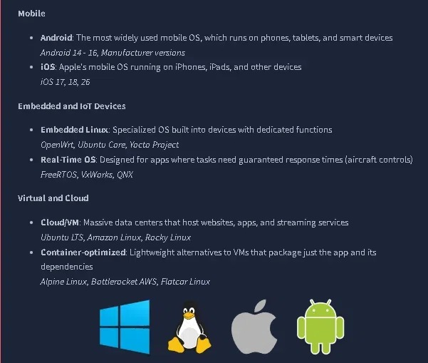
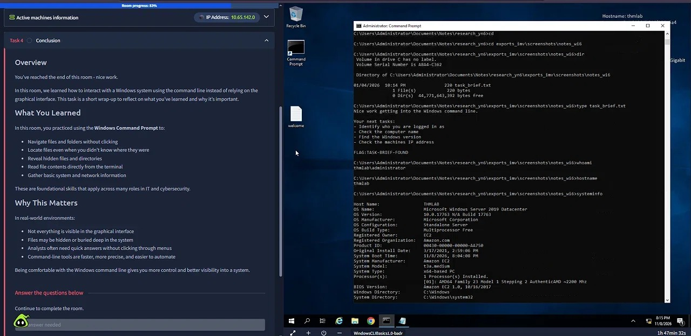
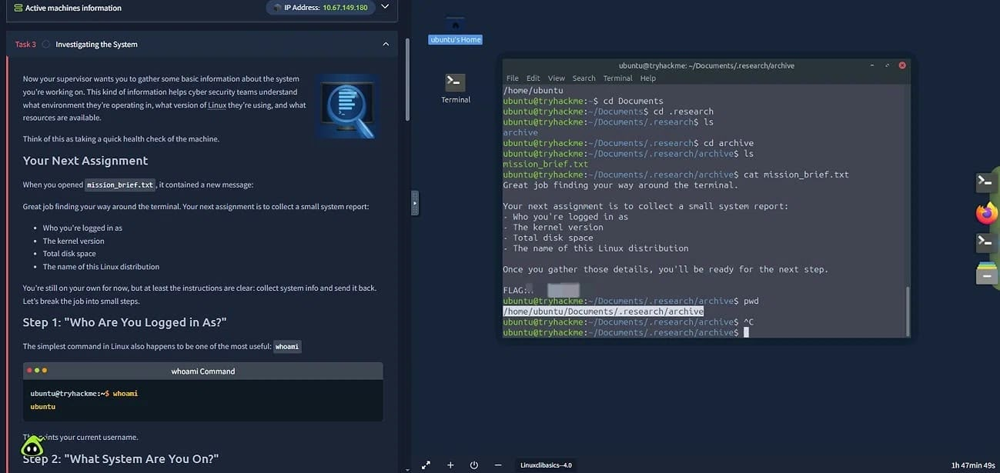
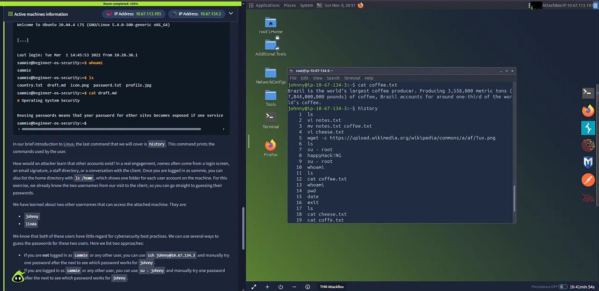

# Module 3: Operating Systems Basics

**Trilha:** Pre Security

**Status:** ✅ Concluido

**Periodo:** 03/11 a 08/11

[← Voltar ao README](../README.md)

---

## Salas

| Sala | Data |
|---|---|
| Operating Systems Introduction | 03/11/2026 |
| Windows Basics | 04/11/2026 |
| Linux Basics | 06/11/2026 |
| Windows Basics | 08/11/2026 |
| Operating System Security | 08/11/2026 |

---

## Operating Systems Introduction ✅

**O que aprendi**
- O **Sistema Operacional (OS)** é o "gerente invisível" que faz a ponte entre hardware, aplicações e usuário
- Separação de privilégios: **Kernel Space** (acesso irrestrito ao hardware, como a torre de controle de um aeroporto) e **User Space** (onde os aplicativos rodam de forma isolada e segura)
- Principais responsabilidades do OS: gerenciamento de processos (multitarefa), memória (RAM e virtual), arquivos, usuários e dispositivos (drivers)
- Panorama dos sistemas operacionais no mundo real (Desktop, Server, Mobile, Embedded, Virtual/Cloud) e a diferença entre **GUI** (interface gráfica) e **CLI** (linha de comando)
- Prática em um ambiente Linux (Ubuntu Mate) na máquina virtual: usei a GUI para verificar informações do sistema (versão, hardware, memória) e navegar por diretórios

**Dificuldade:** associar as responsabilidades do OS a exemplos práticos do dia a dia e se orientar na estrutura de pastas do Linux.

**Lição-chave:** sem o OS, o hardware seria apenas um monte de metal inútil. A separação entre Kernel e User Space garante a estabilidade do sistema (se um app travar, não derruba a máquina inteira) e é a base da segurança da informação.

---

## Windows Basics ✅

**O que aprendi**
- Interface do Windows Server 2019 e estrutura de contas de usuário (Guest, Standard e Administrator), com a importância da autenticação
- **File Explorer**: gerenciar arquivos, entender caminhos (*paths*) e instalar/desinstalar aplicações
- **Gerenciador de Tarefas (Task Manager)**: analisar processos em segundo plano, uso de CPU/RAM e contas de usuário logadas
- **Windows Security**: fiz uma varredura personalizada (*custom scan*) em uma pasta específica e a ferramenta identificou e isolou o arquivo de teste `Virus:DOS/EICAR_Test_File`, uma ameaça simulada
- **Windows Defender Firewall**: regras de entrada e saída, e como os perfis de rede (Domain, Private, Public) protegem o sistema

**Descoberta:** não sabia que o Windows Security fazia varreduras direcionadas, e nunca tinha ido além da aba de aplicativos abertos no Gerenciador de Tarefas.

**Lição-chave:** o Windows tem ferramentas nativas de defesa e monitoramento poderosas (Defender e Task Manager), que são o primeiro passo para qualquer análise de Blue Team. Saber onde olhar e como configurar essas ferramentas é essencial para identificar anomalias.

---

## Linux CLI Basics ✅

**O que aprendi**
- **Terminal (CLI) na cibersegurança:** oferece mais controle, velocidade e acesso a ferramentas que não têm interface gráfica
- **Navegação no sistema de arquivos:** `pwd` (onde estou), `ls` (listar arquivos; `ls -a` mostra os ocultos e `ls -l` os detalhes) e `cd` (mudar de diretório)
- **Busca e leitura de arquivos:** `find ~ -name "arquivo"` procura um arquivo pelo nome a partir da pasta pessoal (`~`), e `cat` mostra o conteúdo
- **Informações do sistema:** `whoami` (usuário atual), `uname -a` (kernel e máquina) e `df -h` (uso de disco em formato legível)

**Dificuldade:** lembrar a sintaxe exata do `find` no desafio final. Esqueci que o comando precisa do diretório de busca e da flag `-name` (`find ~ -name "arquivo"`), e só consegui resolver depois de revisar a estrutura.

**Lição-chave:** o terminal exige precisão. Esquecer o diretório de busca ou uma flag faz o comando falhar. A repetição constrói a memória muscular para comandos como `find`, `ls` e `cat`, que serão a base das investigações em Linux daqui pra frente.

---

## Windows CLI Basics ✅

**O que aprendi**
- **Navegação no Command Prompt (CMD):** `cd` (mostra o diretório atual e muda de pasta) e `dir` (lista arquivos e pastas)
- **Arquivos ocultos e busca:** `dir /a` mostra arquivos e pastas ocultos, e `dir /s <nome_do_arquivo>` busca o arquivo em todas as subpastas
- **Leitura de arquivos:** `type` mostra o conteúdo de arquivos de texto direto no terminal
- **Informações do sistema:** `whoami` (usuário atual), `hostname` (nome da máquina), `systeminfo` (detalhes do SO e do hardware) e `ipconfig` (configuração de rede e IP)

**Comparativo com o Linux CLI**

| Objetivo | Linux | Windows (CMD) |
|---|---|---|
| Ver o diretório atual | `pwd` | `cd` |
| Listar arquivos | `ls` | `dir` |
| Listar ocultos | `ls -a` | `dir /a` |
| Ler um arquivo | `cat` | `type` |
| Buscar um arquivo | `find ~ -name "arquivo"` | `dir /s <nome_do_arquivo>` |
| Usuário atual | `whoami` | `whoami` |

**Observação:** achei os comandos do CMD mais intuitivos que os do Linux (`dir` e `type` são mais fáceis de associar à função do que `ls` e `cat`), o que facilitou a memorização. Não tive dificuldades nesta sala.

**Lição-chave:** o CMD é uma ferramenta poderosa para a análise inicial de um sistema Windows. Comandos como `systeminfo` e `ipconfig` dão um panorama rápido da máquina, e isso é útil para quem investiga um host suspeito ou precisa entender o ambiente, como no trabalho de um analista de Blue Team.

---

## Operating System Security ✅

**O que aprendi**
- **Tríade CIA** (Confidencialidade, Integridade e Disponibilidade): os três pilares da segurança da informação. Ataques a sistemas operacionais buscam quebrar um ou mais deles
- **Principais falhas de segurança em sistemas:**
  - Senhas fracas (a sala mostra a lista das 20 mais comuns, como "123456" e "qwerty")
  - Permissões de arquivos inadequadas, que violam o princípio do **menor privilégio**
  - Programas maliciosos, como Trojans e Ransomware
- **Primeiro laboratório prático de ataque, no AttackBox:** usei o terminal Linux para conectar via SSH (`ssh`), listar arquivos (`ls`), ler textos (`cat`) e consultar o histórico de comandos (`history`)
- **Força bruta manual, em ambiente autorizado do laboratório:** testei as senhas mais comuns para acessar uma conta de usuário e, a partir do histórico de comandos dela, encontrei a credencial do administrador (`root`) e escalei privilégios

**Visão Blue Team**

| Falha | Pilar afetado | Como mitigar |
|---|---|---|
| Senha fraca | Confidencialidade | Senhas fortes e únicas, autenticação multifator (MFA), bloqueio após tentativas falhas |
| Permissões inadequadas | Confidencialidade e Integridade | Princípio do menor privilégio e revisão periódica de permissões |
| Credenciais expostas no histórico de comandos | Confidencialidade | Não digitar senhas em comandos; usar chaves SSH ou gerenciador de segredos |
| Malware (Trojan, Ransomware) | Integridade e Disponibilidade | Antivírus/EDR, sistema atualizado e backups |

**Como detectar:** um ataque de força bruta deixa rastros, como muitas tentativas de login falhas em sequência, geralmente na mesma conta ou vindas do mesmo IP. Em um SOC, esse padrão aparece nos logs de autenticação e pode virar um alerta.

**Dificuldade:** foi meu primeiro laboratório de ataque e a primeira vez aplicando Linux na prática (SSH e histórico de comandos). Conectar e testar as senhas exigiu atenção à sintaxe.

**Lição-chave:** a segurança de um sistema operacional não depende só de anti-malware, mas muito do fator humano. Senhas fracas e o descuido com o histórico de comandos, que pode expor credenciais, são portas de entrada graves para um atacante.

---

## 📝 Resumo do módulo

Este módulo conectou a teoria de hardware do módulo anterior com a camada de software que faz a máquina funcionar.

- **Conceito:** o OS fica entre o hardware e as aplicações, gerencia recursos (memória e processos) e separa privilégios (Kernel vs User Space) para manter o sistema estável
- **Windows:** interface gráfica, Task Manager, defesas nativas (Windows Security e Firewall) e linha de comando (`dir`, `type`, `systeminfo`, `ipconfig`)
- **Linux:** terminal, navegação (`cd`, `ls`), busca (`find`), leitura (`cat`) e informações do sistema
- **Segurança prática:** laboratório em que senhas fracas e credenciais expostas no histórico de comandos levaram à escalada de privilégios até `root`

**Conclusão:** entender Windows e Linux, tanto pela interface quanto pela linha de comando, e saber como podem ser explorados e defendidos é uma base importante para quem quer atuar em Blue Team.

---
