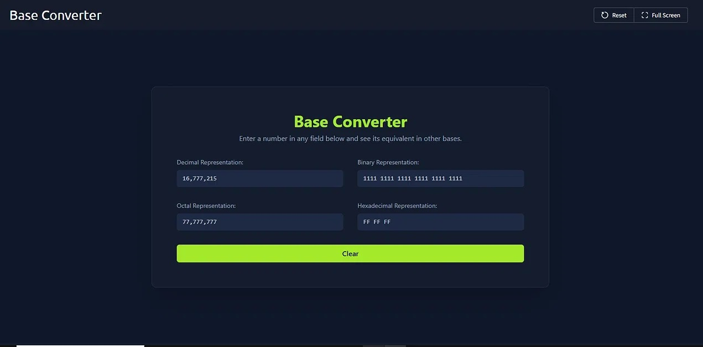

# Module 4: Software Basics

**Status do Módulo:** ⌛ Em Andamento

**Período:** 10/11/2026 - a concluir 

[← Voltar ao README](../README.md)

---

## Salas

| Sala | Data |
|---|---|
| Data Representation | 12/10/2026 ✅ |
| Data Enconding | 15/10/2026 ✅  |
| Python: Simple Demo | ⌛ A fazer |
| JavaScript: Simple Demo | ⌛ A fazer |
| Database SQL Basics | ⌛ A fazer  |

---
## Data Representation ✅

**O que aprendi**
- **Representação de cores:** de um modelo simples de 8 cores (1 bit por cor primária RGB) até o padrão de 24 bits (*True Color*), com 8 bits por canal, que gera mais de 16 milhões de cores
- **Sistema binário (Base-2):** cada posição vale uma potência de 2, e é assim que se converte binário em decimal
- **Sistema hexadecimal (Base-16):** agrupa 4 bits em um único caractere (0 a F), o que facilita a leitura de sequências binárias longas
- **Conversões** entre decimal, binário e hexadecimal (e octal, de forma opcional), com apoio das ferramentas Color Decoder e Base Converter

**Exemplos**
- Binário para decimal: `1011` = 8 + 0 + 2 + 1 = **11**
- Decimal para binário e hexa: `255` = `11111111` = `FF` (o valor máximo de 8 bits)
- Cores em hexa: `#FF0000` = vermelho no máximo (R = FF) e verde e azul zerados (G = 00, B = 00)

**Dificuldade:** foi a sala mais difícil até agora. Demorei para entender a lógica das conversões, principalmente entre binário e decimal nos dois sentidos, porque exige um raciocínio matemático com o qual eu não estava acostumado. Preciso praticar mais para fixar.

**Lição-chave:** o computador trabalha com dois estados (ligado e desligado, 0 e 1), e tudo o que ele guarda (cores, letras, arquivos) é uma tradução disso. A conversão entre bases importa para a segurança porque o hexadecimal aparece o tempo todo em endereços, hashes e na análise de pacotes e de malware.

---
## Data Encoding ✅

**O que aprendi**
- **Encoding (codificação):** o "acordo", ou dicionário, que mapeia números para significados (letras, símbolos, emojis). Sem ele, os dados são apenas bits sem sentido
- **ASCII:** codificação base para o inglês, com 7 bits, e como ler seus valores em decimal, hexadecimal e binário
- **Unicode:** surgiu para resolver o problema dos idiomas que o ASCII não cobre. É o padrão universal que engloba os caracteres do mundo (e emojis)
- **UTF-8, UTF-16 e UTF-32:** formatos de codificação do Unicode que usam quantidades diferentes de bytes por caractere

**Exemplos**
- `A` em ASCII: 65 (decimal) = `41` (hexa) = `01000001` (binário)
- Bytes usados pela letra `A`: 1 em UTF-8, 2 em UTF-16 e 4 em UTF-32
- Em UTF-8, `A` usa 1 byte, `é` usa 2 e um emoji usa 4. Por isso o formato economiza espaço com textos em inglês

**Observação:** a sala é parecida com a de *Data Representation*, mas aplicada ao conteúdo das mensagens em si.

**Dificuldade:** a diferença entre UTF-8, UTF-16 e UTF-32 foi a parte mais densa. Preciso reforçar como cada um lida com os bytes para não confundir em uma investigação real.

**Lição-chave:** erros de encoding não são só um incômodo visual (acentos trocados, interrogações no lugar de letras). Na segurança da informação, atacantes exploram diferenças de interpretação do texto para tentar contornar filtros e injetar *payloads* maliciosos. Entender como o texto vira números é essencial para ler logs e analisar conteúdo suspeito.

---
