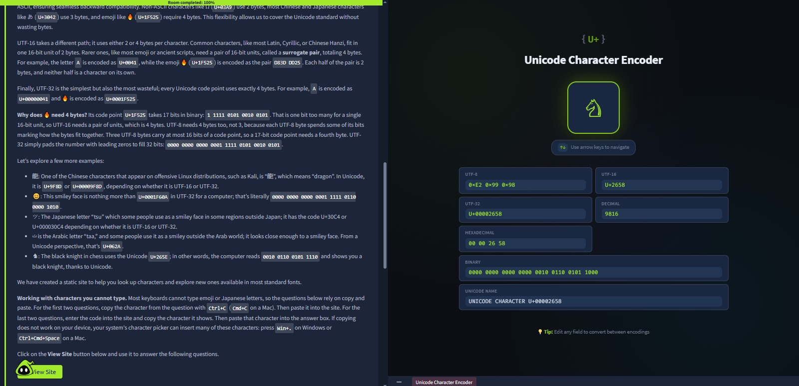
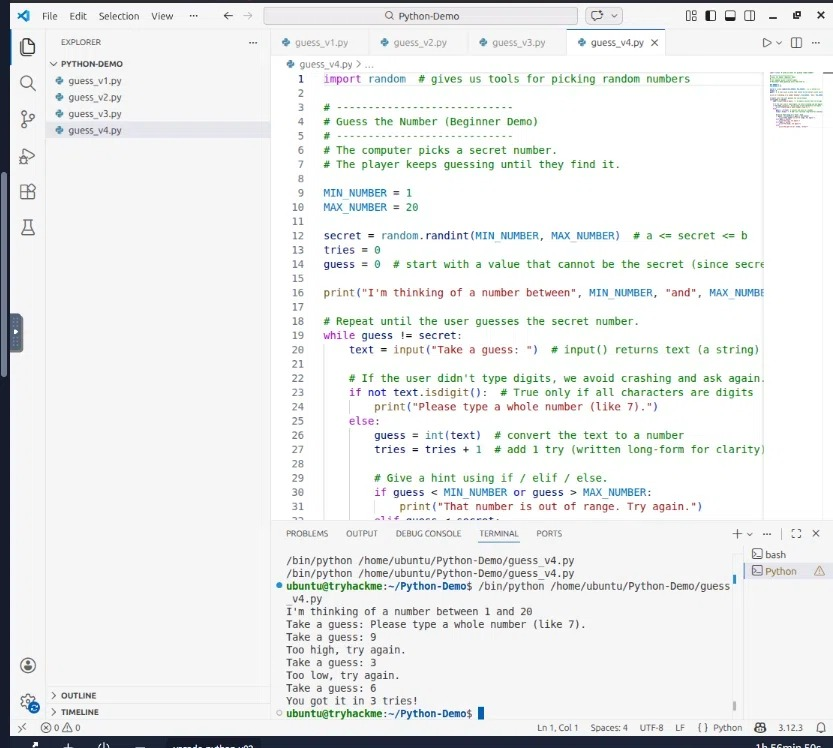
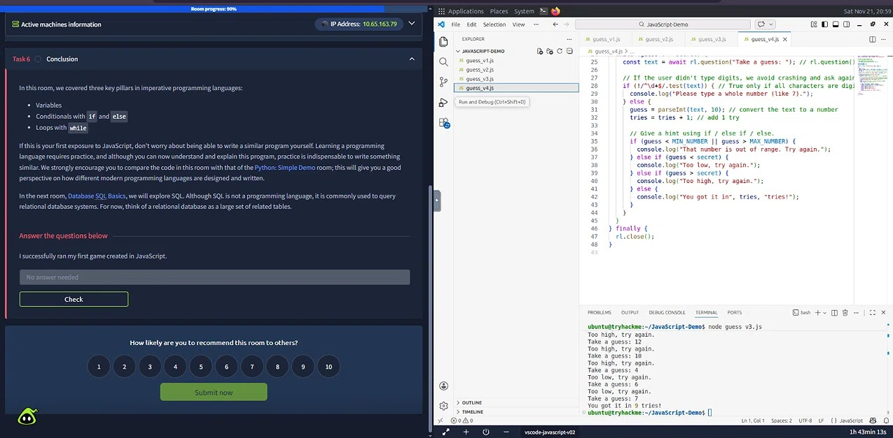
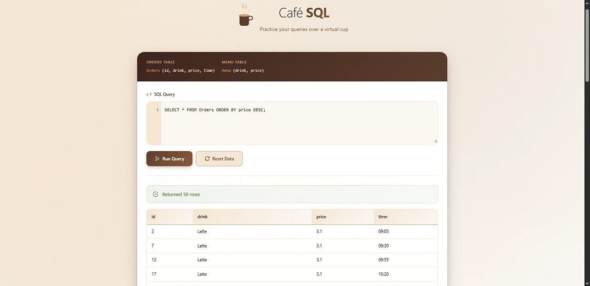

# Module 4: Software Basics

**Status do Módulo:** Concluido ✅

**Período:** 10/11/2026 - a concluir 

[← Voltar ao README](../README.md)

---

## Salas

| Sala | Data |
|---|---|
| Data Representation | 12/10/2026 ✅ |
| Data Enconding | 15/10/2026 ✅  |
| Python: Simple Demo | 17/10/2026 ✅ |
| JavaScript: Simple Demo | 21/10/2026 ✅ |
| Database SQL Basics | 21/10/2026 ✅  |

---
## Data Representation ✅

**O que aprendi**
- **Representação de cores:** de um modelo simples de 8 cores (1 bit por cor primária RGB) até o padrão de 24 bits (*True Color*), com 8 bits por canal, que gera mais de 16 milhões de cores
- **Sistema binário (Base-2):** cada posição vale uma potência de 2, e é assim que se converte binário em decimal
- **Sistema hexadecimal (Base-16):** agrupa 4 bits em um único caractere (0 a F), o que facilita a leitura de sequências binárias longas
- **Conversões** entre decimal, binário e hexadecimal (e octal, de forma opcional), com apoio das ferramentas Color Decoder e Base Converter

**Exemplos**
- Binário para decimal: `1011` = 8 + 0 + 2 + 1 = **11**
- Decimal para binário e hexa: `255` = `11111111` = `FF` (o valor máximo de 8 bits)
- Cores em hexa: `#FF0000` = vermelho no máximo (R = FF) e verde e azul zerados (G = 00, B = 00)

**Dificuldade:** foi a sala mais difícil até agora. Demorei para entender a lógica das conversões, principalmente entre binário e decimal nos dois sentidos, porque exige um raciocínio matemático com o qual eu não estava acostumado. Preciso praticar mais para fixar.

**Lição-chave:** o computador trabalha com dois estados (ligado e desligado, 0 e 1), e tudo o que ele guarda (cores, letras, arquivos) é uma tradução disso. A conversão entre bases importa para a segurança porque o hexadecimal aparece o tempo todo em endereços, hashes e na análise de pacotes e de malware.

---
## Data Encoding ✅

**O que aprendi**
- **Encoding (codificação):** o "acordo", ou dicionário, que mapeia números para significados (letras, símbolos, emojis). Sem ele, os dados são apenas bits sem sentido
- **ASCII:** codificação base para o inglês, com 7 bits, e como ler seus valores em decimal, hexadecimal e binário
- **Unicode:** surgiu para resolver o problema dos idiomas que o ASCII não cobre. É o padrão universal que engloba os caracteres do mundo (e emojis)
- **UTF-8, UTF-16 e UTF-32:** formatos de codificação do Unicode que usam quantidades diferentes de bytes por caractere

**Exemplos**
- `A` em ASCII: 65 (decimal) = `41` (hexa) = `01000001` (binário)
- Bytes usados pela letra `A`: 1 em UTF-8, 2 em UTF-16 e 4 em UTF-32
- Em UTF-8, `A` usa 1 byte, `é` usa 2 e um emoji usa 4. Por isso o formato economiza espaço com textos em inglês

**Observação:** a sala é parecida com a de *Data Representation*, mas aplicada ao conteúdo das mensagens em si.

**Dificuldade:** a diferença entre UTF-8, UTF-16 e UTF-32 foi a parte mais densa. Preciso reforçar como cada um lida com os bytes para não confundir em uma investigação real.

**Lição-chave:** erros de encoding não são só um incômodo visual (acentos trocados, interrogações no lugar de letras). Na segurança da informação, atacantes exploram diferenças de interpretação do texto para tentar contornar filtros e injetar *payloads* maliciosos. Entender como o texto vira números é essencial para ler logs e analisar conteúdo suspeito.

---
### Python: Simple Demo ✅

**Data:** 17/11/2026

**O que aprendi:**
- Criei um jogo de adivinhação ("Guess the Number") no **Visual Studio Code (VS Code)**, aplicando a lógica de programação em Python na prática.
- Compreendi o uso de variáveis (`secret`, `guess` e `tries`), a importação de bibliotecas (como a `random` para gerar o número secreto) e a captura de dados do usuário com o `input()`.
- Estudei a estrutura de tomada de decisão usando condicionais (`if`, `elif` e `else`) para dar feedback ao usuário (se o chute foi alto, baixo ou fora do intervalo).
- Entendi como criar **loops** (usando `while`) para manter o programa rodando até que uma condição seja satisfeita (no caso, até o usuário acertar o número), além de criar a quarta versão (`guess_v4.py`) que incluía a validação da entrada (`isdigit()`) para evitar que o programa quebrasse se o usuário digitasse uma letra em vez de um número.

**Dificuldade:** Não tive dificuldades nesta sala. Achei os fundamentos bem fáceis e tranquilos de acompanhar, pois já tinha visto a grande maioria dessa lógica de programação (variáveis, condicionais e loops) durante a faculdade.

**Lição-chave:** A programação é uma ferramenta fundamental para o profissional de segurança. Entender a lógica por trás do código (como variáveis, loops e condicionais) é o que permite, no futuro, automatizar tarefas repetitivas, criar ferramentas de análise e entender como exploits funcionam.

---
### JavaScript: Simple Demo ✅

**Data:** 21/11/2026

**O que aprendi:**
- Recriei o jogo de adivinhação ("Guess the Number"), mas desta vez utilizando a linguagem **JavaScript**, executando o código através do ambiente **Node.js** e escrevendo no VS Code.
- Compreendi as diferenças estruturais básicas em relação ao Python, como a declaração de variáveis com `let` (que podem mudar) e `const` (constantes que não mudam).
- Utilizei comandos de saída de dados (`console.log`), captura de entrada do usuário (`readline`) e conversão de texto para número (`parseInt`).
- Apliquei a mesma lógica de programação vista anteriormente: estruturas condicionais (`if`, `else if`, `else`) e loops de repetição (`while`), além de operadores lógicos como o `||` (OR) e `!==` (diferente de).

**Dificuldade:** A lógica em si foi tranquila, pois é uma cópia do jogo que fiz em Python. No entanto, notei que o JavaScript é um pouco mais "verboso" e complexo de configurar do que o Python. O Python parece ser mais limpo e direto, enquanto o JavaScript exige a importação de módulos (como o `readline` para ler o teclado) e tem uma sintaxe com mais chaves `{}` e ponto e vírgula `;`. Mas no geral, muitos dos conceitos e comandos são bem parecidos.

**Lição-chave:** Entender que a lógica de programação é universal é um divisor de águas. Uma vez que você entende como fazer um loop ou uma condicional, aprender uma nova linguagem (seja Python, JavaScript, C++) se resume a aprender a nova "sintaxe" ou o novo "sotaque" daquela linguagem. O JavaScript é essencial para a segurança porque rege a maior parte da web, sendo vital para entender ataques como XSS (Cross-Site Scripting).

---
### Database SQL Basics ✅

**Data:** 21/11/2026

**O que aprendi:**
- Compreendi o que é um **Banco de Dados** e por que ele é essencial: em vez de usar anotações em papel (que ficam lentas e confusas com o crescimento), usamos tabelas digitais para armazenar informações de forma organizada.
- Entendi a estrutura de uma tabela: as **Colunas** representam os tipos de informação (ID, nome, preço) e as **Linhas** representam os registros completos (um pedido específico).
- Aprendi a usar o **SQL** (Structured Query Language) para fazer perguntas ao banco de dados (chamadas de *queries*), sem precisar alterar os dados salvos.
- Pratiquei em um laboratório virtual (Café SQL) a escrita das minhas primeiras queries usando os comandos fundamentais: `SELECT` (para escolher colunas), `*` (para selecionar tudo), `FROM` (para definir a tabela), `WHERE` (para filtrar resultados) e `ORDER BY` (para ordenar).

**Dificuldade:** Foi meu primeiro contato mais aprofundado com banco de dados. Achei a lógica das queries bem fácil e autoexplicativa, quase como falar inglês básico com o computador. Não tive dificuldades significativas.

**Lição-chave:** O SQL é a linguagem universal dos dados. Na cibersegurança, entender como as queries funcionam é vital não só para investigar logs e entender sistemas, mas principalmente para proteger aplicações web contra ataques de **SQL Injection**, que é uma das falhas mais comuns e perigosas.

---

## 📝 Resumo do Módulo: Software Basics

Este módulo foi um divisor de águas na minha jornada. Se nos módulos anteriores eu entendi como o hardware funciona e como o Sistema Operacional gerencia a máquina, aqui eu desci um nível para entender **como os dados e o software realmente existem** por baixo dos panos.

A grande linha de raciocínio que construí foi:

1. **Os Dados Brutos (Data Representation e Encoding):** Comecei entendendo que o computador só conhece zeros e uns (bits). Aprendi como traduzir esses bits para cores (sistema Hexadecimal e RGB) e, depois, como a máquina traduz números em texto (ASCII, Unicode, UTF-8). Entendi que "encoding" é um acordo de dicionário entre a máquina e o humano.
2. **A Lógica (Python e JavaScript):** Saí da teoria dos dados e fui para a prática da programação. Criei o mesmo jogo (Guess the Number) em duas linguagens diferentes. Pude perceber na prática que o Python é muito mais limpo e direto, enquanto o JavaScript (rodando no Node.js) exige mais configuração (importação de módulos e sintaxe mais verbosa). No entanto, a lógica de variáveis, condicionais (`if/else`) e loops (`while`) é exatamente a mesma.
3. **A Persistência (Database SQL Basics):** Por fim, vi como as aplicações guardam e consultam informações de forma inteligente. Aprendi a estrutura de tabelas, colunas e linhas e escrevi minhas primeiras *queries* em SQL para filtrar e ordenar dados em um banco de dados relacional.

**Conclusão:** Entender como a informação é codificada, como o software é escrito e como os dados são consultados me deu uma visão muito mais clara das vulnerabilidades. Fica evidente que a segurança da informação não acontece no hardware, mas sim na manipulação desses dados e no código (como falhas de *encoding* e *SQL Injection*). Foi o módulo mais técnico e denso até agora, mas extremamente recompensador.

---
