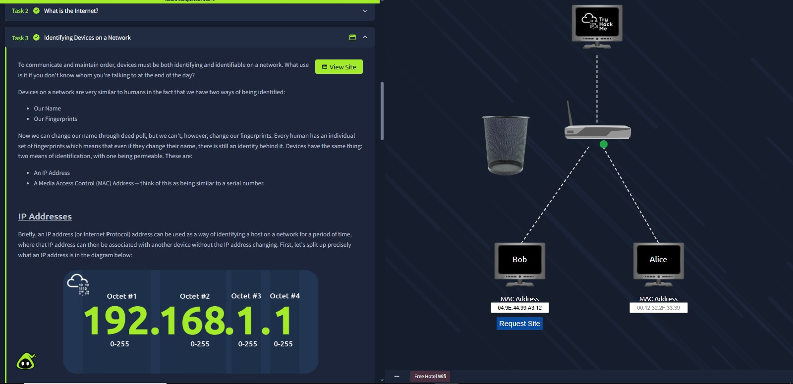
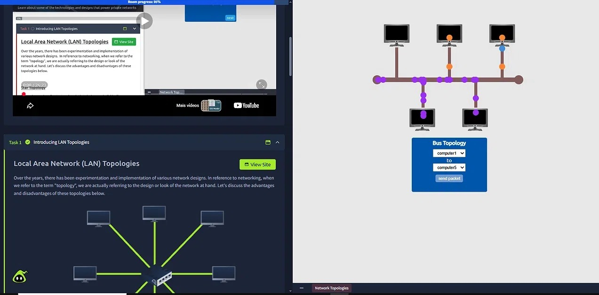

# Module 5: Network Fundamentals

**Status do Módulo:** Em Andamento ⌛

**Período:** 24/11/2026 - A finalizar

[← Voltar ao README](../README.md)

---

## Salas

| Sala | Data |
|---|---|
| What is Networking? | 24/11/2026  |
| Intro to Lan | 25/11/2026   |
| OSI Model | ⌚ A Concluir  |
| Packets & Frames | ⌚ A Concluir |
| Extending Your Network | ⌚ A Concluir   |

---
### What is Networking ✅

**Data:** 24/11/2026

**O que aprendi:**
- Entendi o conceito básico de rede como "coisas conectadas" e como isso se aplica à computação (de 2 a bilhões de dispositivos).
- Compreendi a diferença entre uma **Private Network** (rede local que conecta dispositivos próximos) e a **Internet** (uma rede gigante de redes públicas interconectadas).
- Aprendi como os dispositivos se identificam na rede através de dois endereços: o **IP Address** (que pode mudar, como um nome) e o **MAC Address** (o endereço físico fixo de fábrica, como uma impressão digital).
- Diferenciei endereços IP **IPv4** (32 bits, dividido em 4 octetos) e **IPv6** (128 bits, criado para resolver o esgotamento do IPv4).
- Descobri o conceito de **MAC Spoofing** (falsificação do endereço MAC) e como isso é usado na prática para burlar sistemas de segurança, como em redes Wi-Fi de hotéis que cobram por dispositivo.
- Pratiquei o uso do comando **Ping** (`ping <endereço>`), que usa o protocolo ICMP para testar a conectividade e a latência (tempo de resposta) entre dois dispositivos.

**Dificuldade:** A aula foi bem tranquila e introdutória. Não tive dificuldades significativas em absorver os conceitos.

**Lição-chave:** A identificação na rede (IP e MAC) é a base de toda a comunicação e, consequentemente, de toda a segurança. Entender como um dispositivo se apresenta na rede é o primeiro passo para entender como um atacante pode se passar por outro (Spoofing) e como o Blue Team pode detectar isso.

---
### Intro to LAN ✅

**Data:** 25/11/2026

**O que aprendi:**
- Compreendi as principais **Topologias de Rede** (Star, Bus e Ring), entendendo o funcionamento de cada uma e seus prós e contras (ex: a Star é a mais comum e escalável, mas cara; a Bus é barata, mas sofre com gargalos e ponto único de falha).
- Diferenciei o papel de dois dispositivos essenciais: o **Switch** (conecta dispositivos dentro da mesma rede e envia dados apenas para o destinatário correto, evitando tráfego desnecessário) e o **Router** (conecta redes diferentes e faz o roteamento dos dados).
- Entendi o conceito de **Subnetting** (dividir uma rede grande em redes menores e mais eficientes), compreendendo os tipos de endereços dentro dela (Network, Host e Default Gateway).
- Aprendi como os dispositivos encontram uns aos outros fisicamente usando o protocolo **ARP** (Address Resolution Protocol), que faz a ponte entre o IP e o MAC Address.
- Estudei o processo do **DHCP** (Dynamic Host Configuration Protocol) e como ele atribui IPs automaticamente na rede através do "handshake" (Discover, Offer, Request, ACK).

**Dificuldade:** A sala foi bem densa e com bastante informação teórica, mas os conceitos fluíram bem porque eu já tinha visto a grande maioria deles na faculdade. Achei muito bom rever e aprofundar o assunto das topologias, pois é ótimo saber diferenciar bem cada uma e entender os motivos por trás de cada design.

**Lição-chave:** Entender como a rede é desenhada (topologia) e como os dispositivos se comunicam e se identificam (Switch, Router, ARP, DHCP) é a base de qualquer investigação. Na segurança, saber como o tráfego flui fisicamente e logicamente permite identificar onde colocar defesas (como firewalls) e entender como um atacante pode abusar de protocolos (como ARP Spoofing) para interceptar dados.

---
