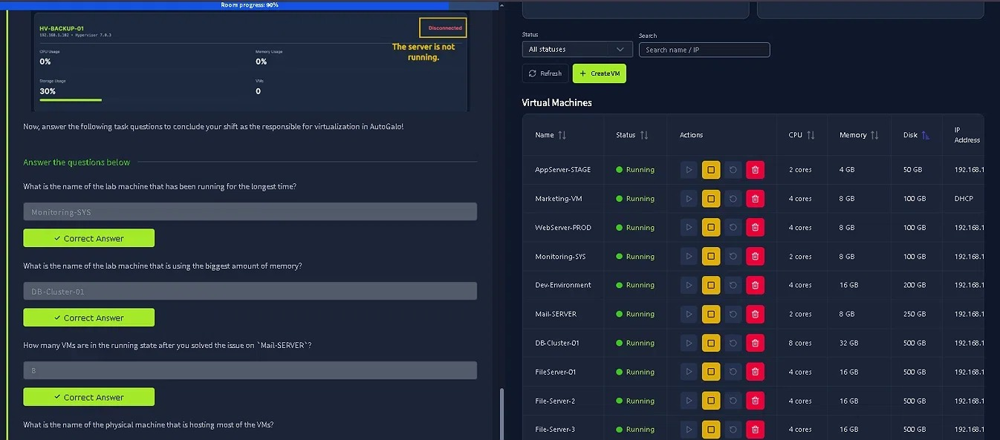
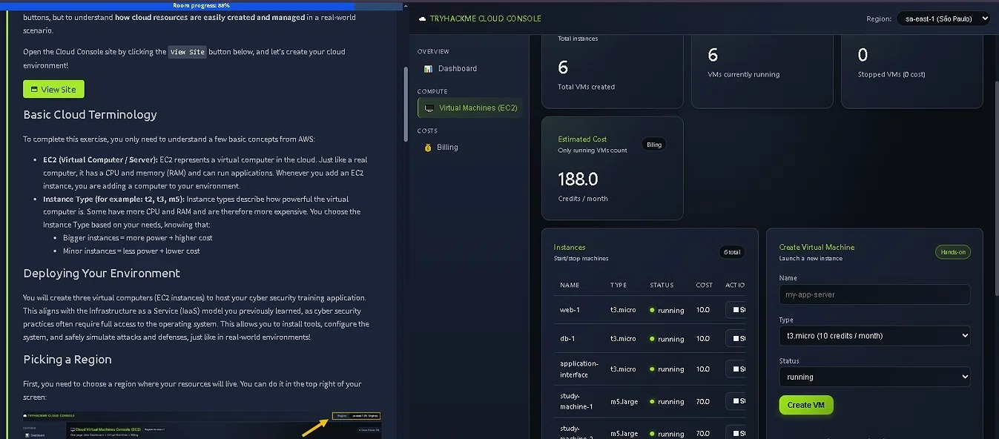
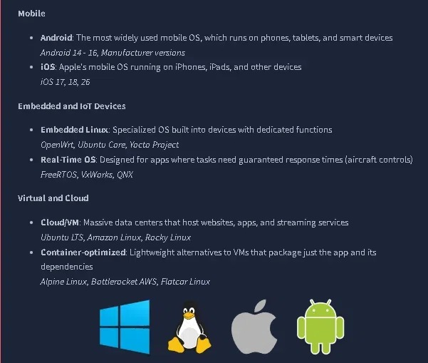

# TryHackMe Journey

Registro da minha jornada de estudos em cibersegurança pela plataforma TryHackMe.

**Objetivo:** construir base prática em segurança da informação, com foco em Blue Team / SOC.

**Trilha atual: Pre Security**

---

## Module 1: Introduction to Cyber Security

**Status:** ✅ Concluído
**Data:** 12/10/2026

### O que aprendi
- O que é cibersegurança e por que ela importa
- Diferença entre ataque e defesa
- Principais áreas de carreira em segurança (SOC, pentest, GRC, etc.)

### Salas concluídas
- Offensive Security Intro
- Defensive Security Intro
- Careers in Cyber

### Observações
- Me identifiquei mais com a área de defesa (Blue Team / SOC).
- Estudando em inglês pra treinar o idioma técnico ao mesmo tempo.

---

## Module 2: Computer Fundamentals

**Status:** ✅ Concluído

**Data de início:** 12/10/2026

### Salas concluídas

#### Inside a Computer System ✅

**Data:** 12/10/2026

**O que aprendi:**
- Componentes do computador: CPU, RAM, armazenamento (HD/SSD), PSU, placa-mãe
- Firmware, UEFI e BIOS (diferença entre eles)
- Sequência de boot: power button → firmware → POST → boot device → bootloader → OS

**Dificuldade:** Tive dificuldade em associar o nome dos componentes em inglês (CPU, GPU, PSU, motherboard, storage). Preciso revisar o vocabulário técnico.

---

### Computer Types ✅

**Data:** 02/11/2026

**O que aprendi:**
- Compreendi as diferenças práticas entre os principais tipos de computadores (Laptop, Desktop, Workstation e Server) e o propósito de design de cada um.
- Entendi o conceito de *trade-off* no hardware (ex: mobilidade custa energia e capacidade de resfriamento, enquanto servidores priorizam redundância e performance contínua).
- Diferenciei dispositivos **IoT** (conectados à rede para enviar dados/receber comandos, como câmeras e smart TVs) de **Embedded Computers** (embutidos em máquinas para executar uma função local sem necessariamente ter conexão com a internet, como o sensor de uma porta automática).

**Dificuldade:** A sala foi bem tranquila e a lógica foi absorvida rapidamente. A única confusão inicial foi separar o conceito de IoT e Embedded, achando que tudo se resumia a IoT, mas a distinção sobre a conectividade com a rede ficou clara.

**Lição-chave:** Não existe o "melhor computador", existe a ferramenta certa para o trabalho certo. O design de cada máquina é um reflexo direto da sua necessidade de mobilidade, poder de processamento ou confiabilidade.

---

### Client-Server Basics ✅

**Data:** 02/11/2026

**O que aprendi:**
- Compreendi o modelo **Client-Server** e como a comunicação na web funciona de forma análoga a um serviço de delivery (o cliente faz o pedido, o servidor responde).
- Entendi a função das **Portas** (identificar o serviço específico rodando no servidor) e do **DNS** (traduzir nomes de domínio para endereços IP, como um GPS).
- Absorvi o conceito de **Protocolo** (as regras e a linguagem acordada entre cliente e servidor para que a requisição e a resposta funcionem).
- Aprendi na prática os fundamentos do **HTTP (GET)**: como usar as ferramentas de desenvolvedor (DevTools) do navegador na máquina virtual para inspecionar requisições, cabeçalhos (headers) e o status `200 OK`.

**Dificuldade:** A sala foi bem tranquila e a didática facilitou muito o entendimento. A primeira experiência utilizando a máquina virtual integrada do TryHackMe fluiu bem, sem travamentos ou dificuldades técnicas.

**Lição-chave:** Toda comunicação na web é baseada em requisições e respostas padronizadas. Entender como o navegador monta um request (e como o servidor responde) é a base para analisar qualquer tráfego de rede no futuro.

---
### Virtualisation Basics ✅

**Data:** 02/11/2026

**O que aprendi:**
- Compreendi o problema da "um servidor = uma aplicação" e como a virtualização resolve isso otimizando o uso do hardware físico (evitando desperdício de CPU, memória e custos altos).
- Entendi o papel do **Hypervisor** (o software que gerencia e aloca recursos) e a diferença entre **Type 1** (bare-metal, ideal para servidores e produção) e **Type 2** (hospedado em um SO, ideal para estudos e testes, como o VirtualBox).
- Diferenciei as **Máquinas Virtuais (VMs)** de **Containers**: VMs simulam um computador inteiro (com seu próprio SO), enquanto containers compartilham o kernel do SO hospedeiro, sendo mais leves e rápidos.
- Pratiquei o gerenciamento de um ambiente virtual simulado (Virtualization Manager), reiniciando VMs com erro, criando uma nova máquina e analisando o consumo de hardware dos servidores físicos.

**Dificuldade:** A sala foi bem tranquila e a dinâmica prática ajudou bastante. A única dificuldade foi entender o conceito de container na teoria, pois o texto em inglês estava um pouco denso, mas com o tempo e a analogia dos "quartos dentro do apartamento" a lógica ficou clara.

**Lição-chave:** A virtualização permite máxima separação e flexibilidade (VMs completas), enquanto os containers oferecem leveza e agilidade para deploy de aplicações escaláveis. Saber escolher entre eles é o que otimiza a infraestrutura moderna.

---
### Cloud Computing Fundamentals ✅

**Data:** 02/11/2026

**O que aprendi:**
- Compreendi a evolução da infraestrutura (Servidores Físicos → Virtualização → Nuvem) e como a computação em nuvem resolveu problemas de custo e limitação física.
- Entendi os benefícios principais do modelo (Escalabilidade, On-demand, Pay-as-you-go, Alta disponibilidade).
- Diferenciei os modelos de implantação (**Public, Private e Hybrid**) e os modelos de serviço usando a analogia do aluguel (**IaaS, PaaS, SaaS**).
- Pratiquei a criação e o gerenciamento de instâncias (EC2) em um console simulado (estilo AWS), criando máquinas virtuais, escolhendo tipos de instância (t3.micro, m5.large) e gerenciando custos.

**Dificuldade:** A sala foi bem tranquila, sem dificuldades técnicas ou teóricas, pois eu já tinha uma base prévia de Cloud por conta da trilha do Google Cloud Cybersecurity.

**Lição-chave:** A nuvem não é sobre *onde* o servidor está, mas sim sobre *como* os recursos são consumidos. É a abstração do hardware físico (via virtualização e containers) que permite escalar aplicações globalmente em minutos e pagar apenas pelo que se usa.

---

## 📝 Resumo do Módulo: Computer Fundamentals

Concluir este módulo foi essencial para consolidar a base de como a infraestrutura de TI funciona, do nível mais baixo ao mais alto. A linha de raciocínio que construí aqui foi:

1. **O Hardware:** Entendi como a máquina física funciona por dentro (CPU, RAM, armazenamento) e que o design de cada computador (seja um laptop ou um servidor) é um *trade-off* focado no seu propósito principal.
2. **A Comunicação:** Vi como essas máquinas conversam através do modelo *Client-Server*, utilizando protocolos (HTTP), portas e o DNS para traduzir endereços e entregar dados pela web.
3. **A Otimização (Virtualização):** Aprendi a resolver o problema do desperdício de hardware. Em vez de "um servidor físico para cada aplicação", usamos *Hypervisors* para criar VMs e *Containers* para rodar softwares de forma isolada e eficiente.
4. **A Escala (Cloud):** Por fim, vi como a virtualização evoluiu para a nuvem. Entendi os modelos de serviço (IaaS, PaaS, SaaS) e como a computação em nuvem permite escalar aplicações globalmente em minutos, pagando apenas pelo que se usa.

**Conclusão:** Sair de "peças de computador" para "como a AWS funciona" em um único módulo me deu a clareza de que a cibersegurança (especialmente o Blue Team) exige entender a fundação da infraestrutura antes de tentar defendê-la.

---

## Module 3: Operating Systems Basics

**Status:** ⏳ Em andamento

**Data:** 03/11/2026

### Operating Systems Introduction ✅

**Data:** 03/11/2026

**O que aprendi:**
- Compreendi o papel do **Sistema Operacional (OS)** como o "gerente invisível" que faz a ponte entre o hardware, as aplicações e o usuário.
- Entendi a separação de privilégios: **Kernel Space** (acesso irrestrito ao hardware, como a torre de controle de um aeroporto) e **User Space** (onde os aplicativos rodam de forma isolada e segura).
- Estudei as principais responsabilidades do OS: gerenciamento de processos (multitarefa), de memória (RAM e virtual), de arquivos, de usuários e de dispositivos (drivers).
- Visualizei o panorama dos sistemas operacionais no mundo real (Desktop, Server, Mobile, Embedded, Virtual/Cloud) e a diferença entre interagir via **GUI** (interface gráfica) e **CLI** (linha de comando).
- Pratiquei a interação com um ambiente Linux (Ubuntu Mate) na máquina virtual, utilizando a GUI para verificar informações do sistema (versão, hardware, memória) e navegar por diretórios.

**Dificuldade:** A sala foi super tranquila e introdutória. A única atenção extra foi necessária para associar as responsabilidades do OS aos exemplos práticos do dia a dia e navegar pela estrutura de pastas do Linux.

**Lição-chave:** Sem o OS, o hardware seria apenas um monte de metal inútil. A separação entre Kernel e User Space é o que garante a estabilidade do sistema (se um app travar, não derruba a máquina inteira) e a base da segurança da informação.

---
### Windows Basics ✅

**Data:** 04/11/2026

**O que aprendi:**
- Naveguei pela interface do Windows Server 2019, entendendo a estrutura de contas de usuário (Guest, Standard e Administrator) e a importância da autenticação.
- Explorei o **File Explorer**, aprendendo a gerenciar arquivos, entender caminhos (paths) e instalar/desinstalar aplicações.
- Mergulhei no **Gerenciador de Tarefas (Task Manager)**: fui além da aba de aplicativos abertos e entendi como analisar processos em segundo plano, uso de CPU/RAM e contas de usuário logadas.
- Descobri o poder do **Windows Security**: realizei uma varredura (custom scan) em uma pasta específica e vi a ferramenta identificar e isolar uma ameaça real simulada (`Virus:DOS/EICAR_Test_File`).
- Entendi o funcionamento do **Windows Defender Firewall**, suas regras de entrada/saída e como os perfis de rede (Domain, Private, Public) protegem o sistema.

**Dificuldade:** A sala foi bem intuitiva, mas a maior surpresa foi descobrir o quão profundo o Windows Security e o Gerenciador de Tarefas podem ser. Eu não sabia que o Windows Security tinha esse poder de fazer varreduras direcionadas e realmente achar vírus, e o gerenciador de tarefas eu nunca fui muito além de só ver os apps que estavam abertos e rodando.

**Lição-chave:** O Windows não é só um ambiente visual; ele tem ferramentas nativas de defesa e monitoramento muito poderosas (como o Defender e o Task Manager) que são o primeiro passo para qualquer análise de Blue Team. Saber onde olhar e como configurar essas ferramentas é essencial para identificar anomalias.

---
| Módulo | Status |
|---|---|
| Introduction to Cyber Security | ✅ Concluído |
| Computer Fundamentals | ✅ Concluído |
| Operating Systems Basics | ⏳ Em andamento |
