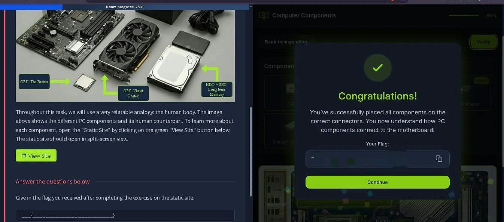
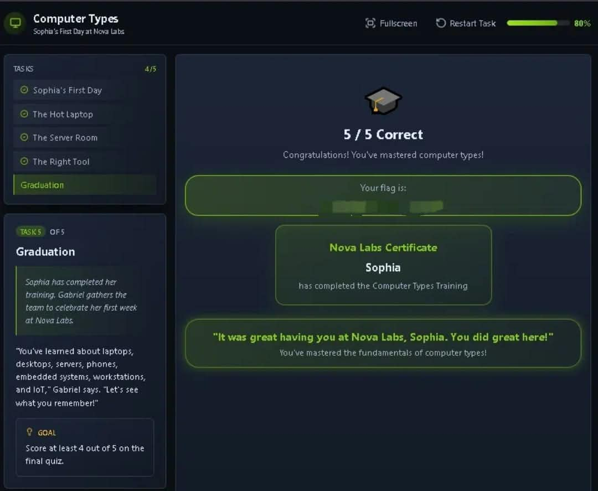
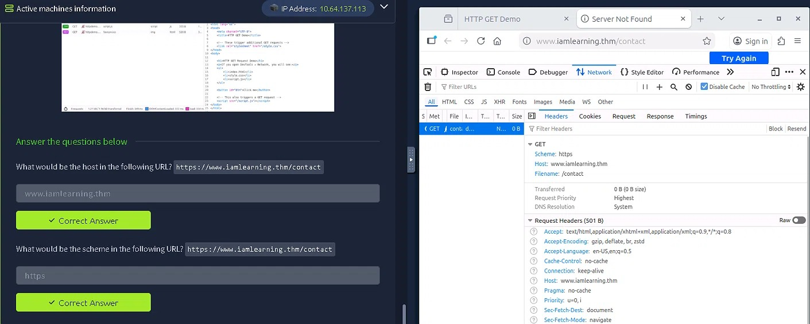

# TryHackMe Journey

Registro da minha jornada de estudos em cibersegurança pela plataforma TryHackMe.

**Objetivo:** construir base prática em segurança da informação, com foco em Blue Team / SOC.

**Trilha atual:** Pre Security (gratuita)

---

## Module 1: Introduction to Cyber Security

**Status:** ✅ Concluído
**Data:** 12/10/2026

### O que aprendi
- O que é cibersegurança e por que ela importa
- Diferença entre ataque e defesa
- Principais áreas de carreira em segurança (SOC, pentest, GRC, etc.)

### Salas concluídas
- Offensive Security Intro
- Defensive Security Intro
- Careers in Cyber

### Observações
- Me identifiquei mais com a área de defesa (Blue Team / SOC).
- Estudando em inglês pra treinar o idioma técnico ao mesmo tempo.

---

## Module 2: Computer Fundamentals

**Status:** ⏳ Em andamento

**Data de início:** 12/10/2026

### Salas concluídas

#### Inside a Computer System ✅

**Data:** 12/10/2026

**O que aprendi:**
- Componentes do computador: CPU, RAM, armazenamento (HD/SSD), PSU, placa-mãe
- Firmware, UEFI e BIOS (diferença entre eles)
- Sequência de boot: power button → firmware → POST → boot device → bootloader → OS

**Dificuldade:** Tive dificuldade em associar o nome dos componentes em inglês (CPU, GPU, PSU, motherboard, storage). Preciso revisar o vocabulário técnico.

---

### Computer Types ✅

**Data:** 02/11/2026

**O que aprendi:**
- Compreendi as diferenças práticas entre os principais tipos de computadores (Laptop, Desktop, Workstation e Server) e o propósito de design de cada um.
- Entendi o conceito de *trade-off* no hardware (ex: mobilidade custa energia e capacidade de resfriamento, enquanto servidores priorizam redundância e performance contínua).
- Diferenciei dispositivos **IoT** (conectados à rede para enviar dados/receber comandos, como câmeras e smart TVs) de **Embedded Computers** (embutidos em máquinas para executar uma função local sem necessariamente ter conexão com a internet, como o sensor de uma porta automática).

**Dificuldade:** A sala foi bem tranquila e a lógica foi absorvida rapidamente. A única confusão inicial foi separar o conceito de IoT e Embedded, achando que tudo se resumia a IoT, mas a distinção sobre a conectividade com a rede ficou clara.

**Lição-chave:** Não existe o "melhor computador", existe a ferramenta certa para o trabalho certo. O design de cada máquina é um reflexo direto da sua necessidade de mobilidade, poder de processamento ou confiabilidade.

---

### Client-Server Basics ✅

**Data:** 02/11/2026

**O que aprendi:**
- Compreendi o modelo **Client-Server** e como a comunicação na web funciona de forma análoga a um serviço de delivery (o cliente faz o pedido, o servidor responde).
- Entendi a função das **Portas** (identificar o serviço específico rodando no servidor) e do **DNS** (traduzir nomes de domínio para endereços IP, como um GPS).
- Absorvi o conceito de **Protocolo** (as regras e a linguagem acordada entre cliente e servidor para que a requisição e a resposta funcionem).
- Aprendi na prática os fundamentos do **HTTP (GET)**: como usar as ferramentas de desenvolvedor (DevTools) do navegador na máquina virtual para inspecionar requisições, cabeçalhos (headers) e o status `200 OK`.

**Dificuldade:** A sala foi bem tranquila e a didática facilitou muito o entendimento. A primeira experiência utilizando a máquina virtual integrada do TryHackMe fluiu bem, sem travamentos ou dificuldades técnicas.

**Lição-chave:** Toda comunicação na web é baseada em requisições e respostas padronizadas. Entender como o navegador monta um request (e como o servidor responde) é a base para analisar qualquer tráfego de rede no futuro.

---

| Módulo | Status |
|---|---|
| Introduction to Cyber Security | ✅ Concluído |
| Computer Fundamentals | ⏳ Em andamento |
| (próximos) | 🔒 A fazer |
